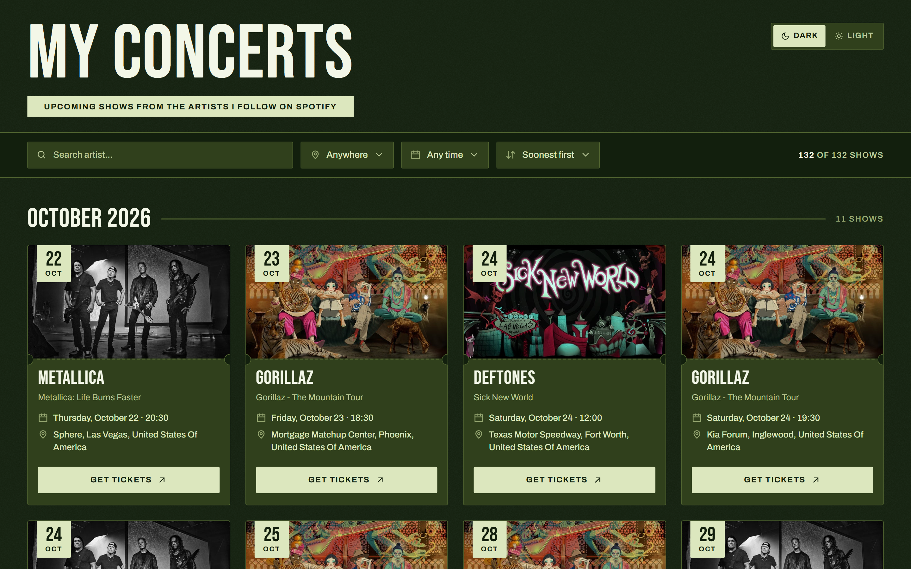
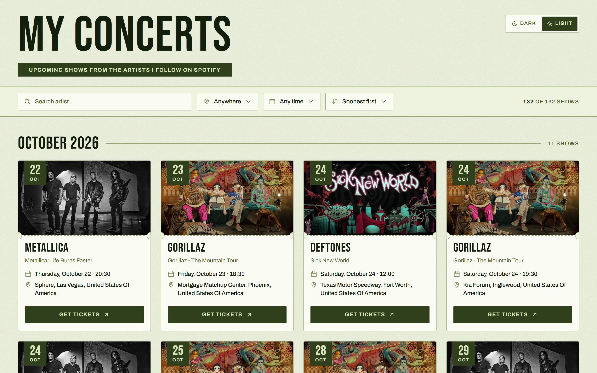
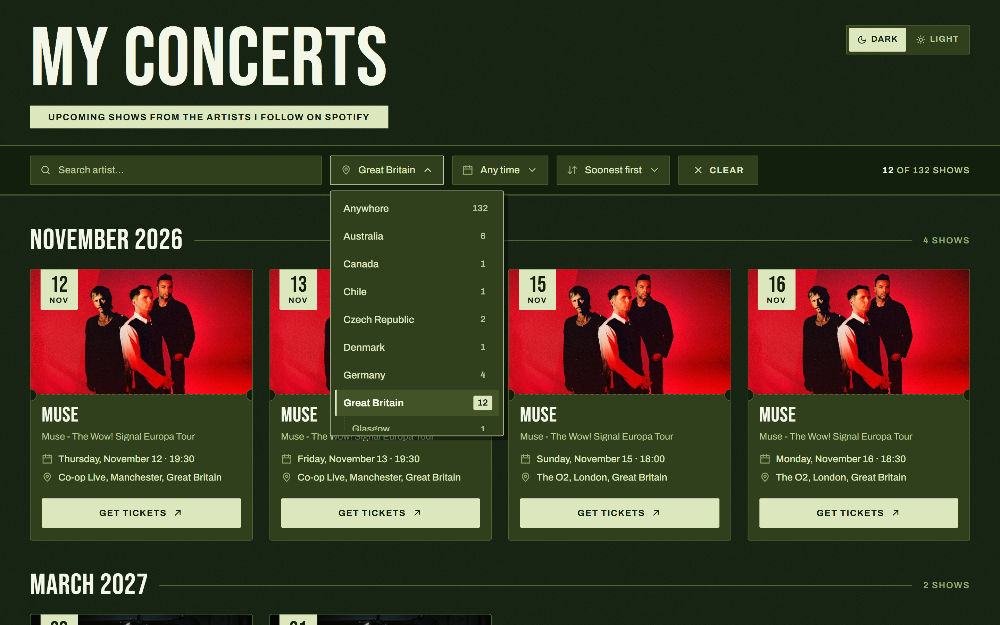
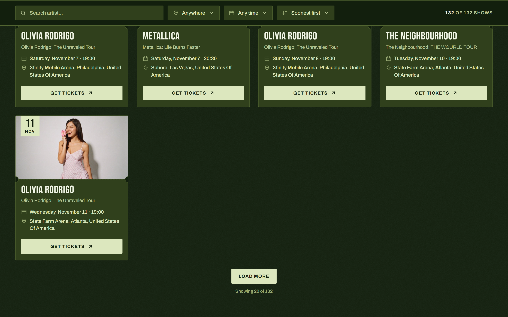
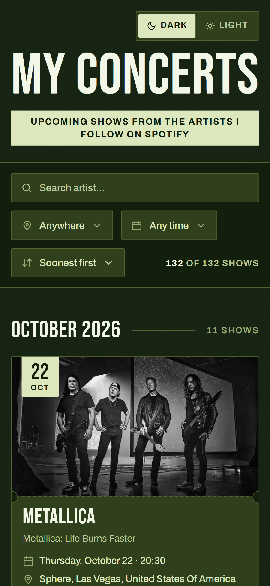
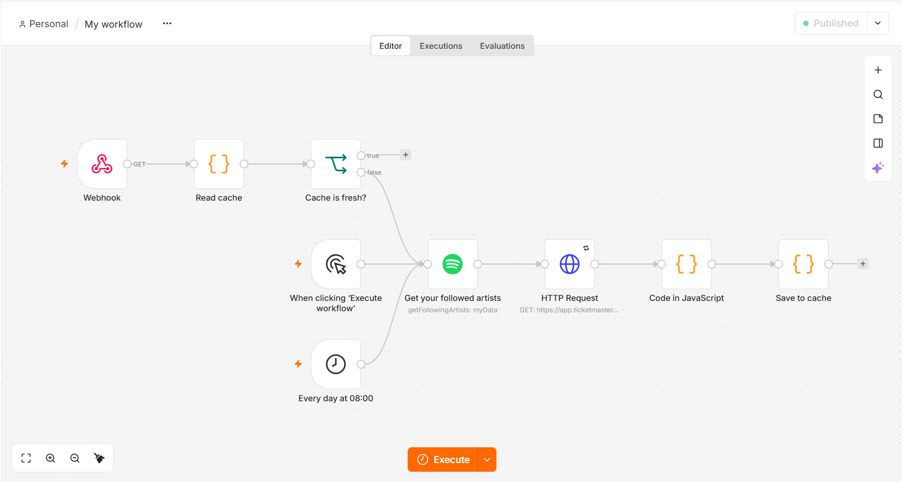

# My Concerts

Upcoming concerts from the artists I follow on Spotify, in one place.

An **n8n** workflow reads my followed artists from Spotify, looks up their shows on the **Ticketmaster Discovery API** and caches the result once a day. An **Angular** app shows them as tickets you can search, filter and page through.



| Light mode | Filter by country and city |
| --- | --- |
|  |  |

| 20 at a time, with "Load more" | On a phone |
| --- | --- |
|  |  |

## Features

- Every upcoming show of the artists you follow on Spotify, grouped by month or by artist
- Search by artist, filter by country/city and period ("This month", "Next 3 months", ...), sort by date or A–Z
- Server-side pagination: 20 concerts per request, more with "Load more"
- Dark and light theme (follows the system setting until you pick one)
- Fast: the workflow refreshes the data once a day, so the page reads from a cache instead of calling Spotify and Ticketmaster on every visit
- Works on phones

## How it works

```
┌──────────────┐      GET /webhook/concerts?offset=0&limit=20&...      ┌──────────────────────────┐
│  Angular app │ ────────────────────────────────────────────────────► │       n8n workflow       │
│ :4200        │ ◄──────────────────────────────────────────────────── │       :5678              │
└──────────────┘          one page of concerts (JSON)                  │                          │
                                                                       │  every day at 08:00,     │
                                                                       │  when the cache is over  │
                                                                       │  24h old, or ?refresh=1: │
                                                                       │  Spotify ─► Ticketmaster │
                                                                       │  ─► cache                │
                                                                       └──────────────────────────┘
```



The workflow has two entry points:

**Refresh (every day at 08:00, or by hand)**

1. **Get your followed artists:** the Spotify node returns every artist you follow.
2. **HTTP Request:** one Ticketmaster Discovery API call per artist (`/discovery/v2/events.json?keyword=<artist>&classificationName=music`).
3. **Code in JavaScript:** keeps only events where the artist is actually performing, removes duplicates, picks a sharp 16:9 image and fills in a missing city or country from the venue's timezone and country code.
4. **Save to cache:** stores the concerts in the workflow's static data. When the refresh was started by the webhook, it also answers with the requested page.

**Webhook (what the app calls)**

1. **Webhook:** `GET /webhook/concerts`
2. **Read cache:** decides whether the cache can be used: it has concerts, they are less than 24 hours old, and the request has no `refresh` param. If so, it returns the requested page (filtered, sorted and cut out). If not (first run, n8n was off at 08:00, or `?refresh=1`), it returns `{ refresh: true }`.
3. **Cache is fresh?** An If node that only routes what Read cache returned; it doesn't look at the cache itself.
   - A page goes out of the *true* output, which isn't connected to anything, so the run ends and n8n answers with that page.
   - `{ refresh: true }` goes out of the *false* output into the refresh above, and **Save to cache** answers at the end.

### The API

`GET http://127.0.0.1:5678/webhook/concerts`

| Query param | Meaning | Default |
| --- | --- | --- |
| `offset` | how many concerts to skip | `0` |
| `limit` | page size (max 100) | `20` |
| `q` | artist name contains | (none) |
| `country`, `city` | exact country / city | (none) |
| `until` | last date, `YYYY-MM-DD` | (none) |
| `sort` | `soonest`, `latest` or `artist` | `soonest` |
| `refresh` | `1` to ignore the cache and fetch everything again | (none) |

```jsonc
{
  "items": [ /* up to `limit` concerts: artist, event, date, time, venue, city, country, url, image */ ],
  "offset": 0,
  "sort": "soonest",
  "total": 45,        // concerts that match the filters
  "all": 132,         // all upcoming concerts
  "countries": [ { "name": "Greece", "count": 3, "cities": [ { "name": "Athens", "count": 3 } ] } ],
  "groupCounts": { "2026-11": 12 }   // shows per month (or per artist when sorted A–Z)
}
```

Concerts that already happened and Ticketmaster's "Premium Package" VIP listings are always left out.

## Tech stack

- **Frontend:** Angular 22 (standalone components, signals, `httpResource`, `linkedSignal`), plain CSS with custom properties for theming, Vitest for tests
- **Backend:** n8n 2 (Spotify node, HTTP Request, Code nodes, Schedule Trigger, Webhook)
- **Data:** Spotify Web API, Ticketmaster Discovery API

## Running it yourself

You need your **own Spotify app** and your **own Ticketmaster API key**. Neither is included in this repository.

### Prerequisites

- Node.js (an Active LTS release; developed on Node 24)
- n8n, either with `npx n8n` or [installed another way](https://docs.n8n.io/hosting/installation/)
- A Spotify account that follows some artists

### 1. Get a Ticketmaster API key

1. Create an account at [developer.ticketmaster.com](https://developer.ticketmaster.com/).
2. Open **My Apps**. Your app's **Consumer Key** is the API key.

### 2. Start n8n

Spotify doesn't accept `localhost` in redirect URIs, and n8n builds its OAuth Redirect URL from its own settings (not from the address in your browser). So tell n8n to use `127.0.0.1`:

```bash
# macOS / Linux
N8N_EDITOR_BASE_URL=http://127.0.0.1:5678 npx n8n
```

```powershell
# Windows (PowerShell)
$env:N8N_EDITOR_BASE_URL = "http://127.0.0.1:5678"; npx n8n
```

Open `http://127.0.0.1:5678` and create your n8n account.

### 3. Create a Spotify app and connect it to n8n

1. In n8n, create a new **Spotify OAuth2 API** credential. It shows an **OAuth Redirect URL**: `http://127.0.0.1:5678/rest/oauth2-credential/callback`. Copy it and keep the dialog open.
2. In the [Spotify Developer Dashboard](https://developer.spotify.com/dashboard), create an app (choose **Web API**) and add that URL as a **Redirect URI**.
3. Copy the app's **Client ID** and **Client Secret** into the n8n credential and connect your Spotify account.

> A new Spotify app runs in *development mode*: only the Spotify accounts you add under **User Management** in the dashboard can log in. That's fine for personal use.

### 4. Build the n8n workflow

1. Build the workflow described in [How it works](#how-it-works). The code of the three Code nodes is in [`n8n/`](n8n/); paste each file into the node with the same name:

   | Node | Settings |
   | --- | --- |
   | Schedule Trigger | every day at 08:00 |
   | Spotify | Resource: *My Data*, Operation: *Get Following Artists*, Return All: on |
   | HTTP Request | `GET https://app.ticketmaster.com/discovery/v2/events.json`, query params `apikey` = your key, `keyword` = `{{ $json.name }}`, `classificationName` = `music`. Batching: 4 items per batch. Settings: Retry On Fail |
   | Code in JavaScript | [`n8n/code-in-javascript.js`](n8n/code-in-javascript.js) |
   | Save to cache | [`n8n/save-to-cache.js`](n8n/save-to-cache.js) |
   | Webhook | `GET`, path `concerts`, Respond: *When Last Node Finishes*, Response Data: *First Entry JSON*, Allowed Origins (CORS): `*` |
   | Read cache | [`n8n/read-cache.js`](n8n/read-cache.js) |
   | Cache is fresh? | If node, condition `{{ $json.refresh !== true }}` is true (Boolean). *true* output: leave empty (that ends the run and answers the request). *false* output: connect to the Spotify node |

   Connect the Schedule Trigger to the Spotify node too, then Spotify → HTTP Request → Code in JavaScript → Save to cache.

2. In the workflow's **Settings**, set the **Timezone** (e.g. `Europe/Athens`) so "08:00" and "today" mean your local time.
3. **Save** and **Publish** the workflow.

### 5. Run the app

```bash
cd frontend
npm install
npm start
```

Open [http://localhost:4200](http://localhost:4200).

The first load takes up to a minute while n8n fetches everything; after that the page loads right away. The app expects the webhook at `http://127.0.0.1:5678/webhook/concerts`. If yours is somewhere else, change `CONCERTS_URL` in [`frontend/src/app/services/concerts.ts`](frontend/src/app/services/concerts.ts).

### Refreshing by hand

Followed a new artist and don't want to wait until 08:00? Open:

```
http://127.0.0.1:5678/webhook/concerts?refresh=1
```

It takes about a minute. If you get `{"message":"Error in workflow"}`, Ticketmaster timed out on one of the requests; open the link again.

## Tests

```bash
cd frontend
npm test          # 37 unit tests (Vitest)
npm run build     # production build in frontend/dist
```

The tests cover the concert list (pagination, filters, search, sorting, empty and error states), the concert card, the dropdown, the theme switch and the API service. They use a fake HTTP backend, so n8n doesn't need to be running.

## Project structure

```
concerts-app/
├── README.md
├── screenshots/
├── n8n/                           code of the workflow's Code nodes (no keys or credentials)
│   ├── code-in-javascript.js      Ticketmaster events → concerts
│   ├── save-to-cache.js           stores them, answers the page after a refresh
│   └── read-cache.js              answers the page from the cache
└── frontend/                      Angular app
    └── src/
        ├── index.html             picks the theme before Angular loads (no flash)
        ├── styles.css             colors, themes, buttons
        └── app/
            ├── models/concert.ts  Concert, ConcertQuery, ConcertPage
            ├── services/
            │   ├── concerts.ts    httpResource for one page of concerts
            │   └── theme.ts       dark / light, saved in localStorage
            └── components/
                ├── concert-list/  toolbar, filters, groups, "Load more"
                ├── concert-card/  one concert, styled as a ticket
                ├── dropdown/      menu used by the filters
                └── theme-toggle/  the Dark / Light switch
```

## Limitations

- n8n has to be running for the app to show anything, and for the 08:00 refresh to happen.
- Ticketmaster returns up to 20 events per artist (its default page size), so artists with very long tours may be missing some dates.
- Ticketmaster's search is by keyword, so an artist with a very common name can match other events. The workflow keeps only events that list the artist as a performer.
